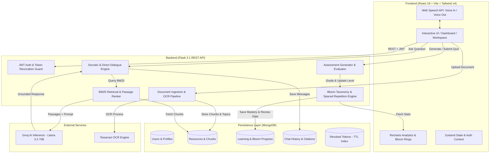

# 🎓 Learn with Socrates

> **An AI-Powered Cognitive Learning Platform combining Retrieval-Augmented Generation (RAG), Bloom's Taxonomy Mastery Tracking, Socratic Dialogue Engine, and Ebbinghaus Spaced Repetition.**

[](https://react.dev/)
[](https://vitejs.dev/)
[](https://tailwindcss.com/)
[](https://flask.palletsprojects.com/)
[](https://www.mongodb.com/)
[](https://groq.com/)
[](https://www.python.org/)
[](LICENSE)

---

## 📑 Table of Contents
- [Executive Overview](#-executive-overview)
- [The Problem & The Solution](#-the-problem--the-solution)
- [Core Features](#-core-features)
- [System Architecture](#-system-architecture)
- [Pedagogical Engineering & Algorithms](#-pedagogical-engineering--algorithms)
  - [1. Bloom's Taxonomy Cognitive Hierarchy](#1-blooms-taxonomy-cognitive-hierarchy)
  - [2. Ebbinghaus Spaced Repetition Scheduling](#2-ebbinghaus-spaced-repetition-scheduling)
  - [3. Dual-Pedagogy Engine (Socratic vs Direct)](#3-dual-pedagogy-engine-socratic-vs-direct)
  - [4. Context-Aware RAG Pipeline (BM25 + Strict Source Citations)](#4-context-aware-rag-pipeline-bm25--strict-source-citations)
- [Engineering Highlights & Architectural Trade-offs](#-engineering-highlights--architectural-trade-offs)
- [Tech Stack](#-tech-stack)
- [Database Schema & Collections](#-database-schema--collections)
- [API Reference](#-api-reference)
- [Getting Started (Local Setup)](#-getting-started-local-setup)
- [Environment Variables](#-environment-variables)
- [Security & Production Hardening](#-security--production-hardening)

---

## 💡 Executive Overview

**Learn with Socrates** is an intelligent, full-stack educational ecosystem engineered to transition students from **passive content consumption** to **active cognitive mastery**. 

Rather than acting as a standard conversational chatbot that simply spits out answers, Socrates is modeled after classical pedagogical methods:
1. It ingests complex student learning materials (PDFs, Slide Decks, Word documents, and Scanned Images with OCR).
2. It breaks materials down into hierarchical chapters, extracted topics, and retrievable knowledge chunks.
3. It guides learners via **Socratic dialogue** (probing questions, hypothesis testing, and scaffolded hints) or **Direct explanation** depending on the student's cognitive state.
4. It dynamically measures student understanding across all **6 levels of Bloom's Taxonomy**, scheduling automated review sessions using **Ebbinghaus spaced repetition intervals**.

---

## 🎯 The Problem & The Solution

| The Traditional Problem | The Socrates Solution |
|---|---|
| **Illusion of Competence**: Students read summaries or watch video tutorials, believing they understand concepts without ever being tested on them. | **Evidence-Based Mastery**: Mastery score is derived strictly from graded assessments across all 6 Bloom levels, never merely from reading or viewing material. |
| **LLM "Answer-Dumping"**: Standard AI chatbots instantly solve problems for students, stripping away critical thinking and problem-solving opportunities. | **Socratic Inquiry Engine**: Socrates responds with thought-provoking questions, asks students to justify their reasoning, and isolates conceptual blind spots. |
| **Rapid Knowledge Decay**: Forgetting curve causes students to lose over 70% of newly acquired concepts within 48 hours without targeted review. | **Algorithmic Spaced Repetition**: Dynamic revision scheduling intervals ($1, 3, 7, 14, 30, 60$ days) triggered by assessment performance. |
| **Hallucination & Lack of Verifiability**: AI tutors hallucinate explanations not grounded in the student's actual course syllabus or textbook. | **Grounded RAG with Real Source Citations**: BM25 lexical retrieval injects verified text passages, requiring the LLM to cite specific pages and slide numbers (`[S1]`, `[S2]`). |

---

## ✨ Core Features

### 📚 1. Multi-Format Document Intelligence & RAG
- **Zero-Friction Ingestion**: Upload academic PDFs, PowerPoint presentations (`.pptx`), Word documents (`.docx`), plain text (`.txt`), and images (`.png`, `.jpg`, `.jpeg`).
- **Integrated OCR**: Automatic Optical Character Recognition via Tesseract for scanned lecture notes and textbook photos.
- **Hierarchical Extraction**: Parses documents into Chapters, Topics, and semantic Chunks (~900 characters each) with slide/page offsets.
- **In-Memory & Database BM25 Retrieval**: Fast, deterministic lexical search without external vector DB latency or embedding API costs.

### 🏛️ 2. Dual-Mode Pedagogical Tutor
- **Socratic Mode**: Guides through guided inquiry, analogy-building, counter-examples, and reflective questioning.
- **Direct Explanation Mode**: Provides concise, structured breakdowns with step-by-step logic, code formatting, and mathematical equations.
- **Seamless Mode Switching**: Toggle between Socratic and Direct modes mid-conversation with full conversational context retention.

### 🎙️ 3. "Ask Socrates" Hands-Free Voice Tutoring
- Built directly on top of the browser's native **Web Speech API** (`SpeechRecognition` & `SpeechSynthesis`).
- Zero external speech API billing; ultra-low latency audio processing with real-time waveform and animated visual feedback.

### 🧠 4. Bloom's Taxonomy Cognitive Progression
- Tracks learning progress across 6 cognitive tiers:
  1. **Remember**: Definitions, formulas, core facts.
  2. **Understand**: Explaining ideas in student's own words.
  3. **Apply**: Utilizing concepts to solve concrete problems.
  4. **Analyze**: Distinguishing components and finding causal relationships.
  5. **Evaluate**: Defending stances, judging solutions, and critiquing trade-offs.
  6. **Create**: Designing new systems, synthesizing novel solutions.
- Blended scoring with exponential moving averages ($0.6 \times \text{prior} + 0.4 \times \text{new}$).

### 📝 5. Dynamic Diagnostics & Automated Grading
- Generates targeted diagnostic quizzes tailored to the student's current Bloom level.
- Automated AI evaluation providing instant score computation, comprehensive rationale breakdowns, and actionable remediation tips.

### 📊 6. Comprehensive Student Analytics
- Visual radar charts, Bloom mastery progress rings, time-on-task metrics, study streaks, and comparative velocity charts (Socratic vs Direct) powered by **Recharts**.

---

## 🏗️ System Architecture



---

## 🔬 Pedagogical Engineering & Algorithms

### 1. Bloom's Taxonomy Cognitive Hierarchy
A topic's mastery status is **not** based on time spent or pages read. It requires demonstrated competence through assessment across all 6 tiers:
$$\text{Topic Mastery} = \frac{1}{6} \sum_{i=1}^{6} \text{Score}(\text{Level}_i)$$
A topic enters the **`Mastered`** status if and only if:
$$\forall i \in \{1..6\}: \quad \text{Attempts}_i \ge 1 \quad \land \quad \text{Score}_i \ge 0.70$$

Whenever a student submits a new assessment at Level $L$, the running score is updated using an **exponential smoothing update**:
$$\text{Score}_{\text{new}} = 0.60 \times \text{Score}_{\text{previous}} + 0.40 \times \text{Score}_{\text{attempt}}$$

### 2. Ebbinghaus Spaced Repetition Scheduling
To counteract cognitive decay (the Ebbinghaus Forgetting Curve), Socrates calculates review intervals upon successful assessment completion:
$$\text{Intervals (Days)} = [1, 3, 7, 14, 30, 60]$$
- If the student scores $\ge 70\%$, their review counter increments, pushing the next review date exponentially further out:
  $$\text{Next Review Date} = \text{Current Time} + \Delta t_{\text{Interval}[\min(\text{review\_count}, 5)]}$$
- If the student scores $< 70\%$, the interval resets to $1 \text{ day}$ for rapid remediation.

### 3. Dual-Pedagogy Engine (Socratic vs Direct)
- **Socratic Mode System Prompting**:
  - Enforces the **maieutic method**: never gives the direct final answer.
  - Asks one focused question at a time to keep cognitive load manageable.
  - Builds on student inputs; identifies logical fallacies gently with analogies.
- **Direct Mode System Prompting**:
  - Provides concise, authoritative explanations with clear definitions, bullet points, syntax highlighting, and LaTeX math formatting.
  - Both modes maintain continuous access to the same conversation history.

### 4. Context-Aware RAG Pipeline (BM25 + Strict Source Citations)
- **Document Chunking**: Ingested files are segmented into sliding windows of $\approx 900$ characters with a 150-character overlap, retaining document metadata (`resource_id`, `chapter_id`, `page_number`, `slide_number`).
- **BM25 Lexical Ranking**: Top $k$ passages are ranked using Okapi BM25 scoring over inverted index term frequencies:
  $$\text{Score}(D, Q) = \sum_{i=1}^{n} \text{IDF}(q_i) \cdot \frac{f(q_i, D) \cdot (k_1 + 1)}{f(q_i, D) + k_1 \cdot \left(1 - b + b \cdot \frac{|D|}{\text{avgdl}}\right)}$$
- **Hallucination Guardrails**:
  - Top passages are injected into the prompt wrapped in untrusted `<passage id="S#">` tags.
  - The model is instructed: *"Base your response solely on the provided passages. Cite source tags `[S#]` for factual claims. If the information is not present, explicitly state that the uploaded documents do not cover it."*
  - The server post-processes `[S#]` markers, translating them into clickable page/slide citations on the frontend.

---

## 🛠️ Engineering Highlights & Architectural Trade-offs

### 1. Why BM25 over Dense Vector Embeddings?
- **Zero API Dependency & Predictable Latency**: Groq does not offer an embedding API. Utilizing BM25 eliminates external embedding API latency, network hops, and additional SaaS costs.
- **Precision for Academic Texts**: Technical literature, slide decks, and code tutorials rely heavily on exact keywords, formulas, and terminology, where lexical matching frequently outperforms or matches dense retrieval without vector drift.

### 2. Referential Integrity in NoSQL (PyMongo Cascade Engine)
- MongoDB does not provide native foreign-key cascade deletions. To prevent orphaned documents when a user deletes a resource or subject, a custom cascade engine (`app/cascade.py`) manages cascading cleanup across `chapters`, `extracted_topics`, `resource_chunks`, `chat_messages`, `bloom_progress`, and `learning_progress`.
- A transactional atomic `counters` collection generates deterministic integer `_id`s, ensuring URL-friendly API endpoints (`/api/resources/42`).

### 3. Client-Side Web Speech vs Cloud Speech APIs
- Leveraging browser-native `SpeechRecognition` and `SpeechSynthesis` eliminates audio streaming bandwidth costs, removes audio data privacy concerns, and provides instant zero-roundtrip text-to-speech rendering.

### 4. Enterprise-Grade Security & User Isolation
- **Strict Tenant Scoping**: Every single database query filters by `user_id = uid()`. A user can never read, modify, or delete another user's resources or analytics.
- **Magic Byte File Signature Validation**: File uploads are verified against true byte signatures (`%PDF`, `PK`, `\x89PNG`, `\xff\xd8`), preventing extension-spoofing attacks.
- **Stateless JWT with Server-Side Revocation**: Logout operations write the token's unique identifier (`jti`) to a `revoked_tokens` collection with a MongoDB TTL index that automatically purges expired tokens.

---

## 💻 Tech Stack

### Frontend
- **Framework**: [React 18.3](https://react.dev/) + [Vite 6.0](https://vitejs.dev/)
- **Styling**: [Tailwind CSS v4.1](https://tailwindcss.com/)
- **Component Primitives**: Radix UI, Class Variance Authority (`cva`), Lucide React
- **Data Visualization**: [Recharts 2.15](https://recharts.org/)
- **Markdown & Math**: `react-markdown`, `remark-gfm`, `remark-math`, `rehype-katex`, `KaTeX`
- **Form Management**: `react-hook-form` + `zod` validation
- **State Management**: [Zustand 5.0](https://zustand-demo.pmnd.rs/) + Axios Interceptors

### Backend
- **Framework**: [Flask 3.1](https://flask.palletsprojects.com/)
- **Database Driver**: [PyMongo 4.10](https://pymongo.readthedocs.io/)
- **Authentication**: `Flask-JWT-Extended` with JWT blocklist
- **Rate Limiting**: `Flask-Limiter`
- **Document Processing**: `PyMuPDF` (PDF parsing), `python-docx` (Word), `python-pptx` (PowerPoint), `Pillow` (Image processing)
- **OCR Engine**: `pytesseract` (Google Tesseract OCR)
- **AI / LLM Integration**: [Groq Cloud API](https://groq.com/) (OpenAI-compatible client with JSON mode)

---

## 🗄️ Database Schema & Collections

| Collection | Purpose | Key Fields |
|---|---|---|
| `users` | User credentials & profile | `_id`, `email`, `password_hash`, `name`, `created_at` |
| `revoked_tokens` | JWT token blocklist for logout | `_id`, `jti`, `created_at` *(TTL index auto-deletes)* |
| `subjects` | Academic subject grouping | `_id`, `user_id`, `name`, `created_at` |
| `resources` | Uploaded learning materials | `_id`, `user_id`, `subject_id`, `filename`, `file_type`, `status` |
| `chapters` | Auto-extracted document units | `_id`, `resource_id`, `title`, `order` |
| `extracted_topics` | Granular concepts per chapter | `_id`, `resource_id`, `chapter_id`, `title`, `description` |
| `resource_chunks` | Searchable text chunks for RAG | `_id`, `resource_id`, `content`, `page_number`, `slide_number` |
| `chat_messages` | Multi-turn tutoring history | `_id`, `user_id`, `topic_id`, `mode`, `role`, `content`, `citations` |
| `bloom_progress` | Per-level Bloom score & attempts | `_id`, `user_id`, `topic_id`, `level` (1-6), `score`, `attempts` |
| `learning_progress`| Overall topic mastery & schedule | `_id`, `user_id`, `topic_id`, `mastery`, `status`, `next_review_at` |
| `assessments` | Generated quizzes & answers | `_id`, `user_id`, `topic_id`, `level`, `questions`, `score` |

---

## 🔌 API Reference

### Authentication (`/api/auth`)
- `POST /api/auth/register` - Create a new student account.
- `POST /api/auth/login` - Authenticate and receive JWT access token.
- `POST /api/auth/logout` - Revoke current JWT token (added to blocklist).
- `GET  /api/auth/me` - Fetch authenticated user profile.

### Resources & Ingestion (`/api`)
- `GET  /api/subjects` - List all subjects with resource counts.
- `POST /api/subjects` - Create a new subject category.
- `GET  /api/resources` - List all uploaded documents with processing statuses.
- `POST /api/resources/upload` - Upload file (`.pdf`, `.docx`, `.pptx`, images). Rate-limited to 30/hour.
- `GET  /api/resources/:id` - Fetch document metadata, chapters, and topics.
- `DELETE /api/resources/:id` - Cascade-delete resource and all linked chunks, topics, and chat history.

### Learning & Dialogue (`/api/learning`)
- `GET  /api/learning/topics/:id/chat` - Retrieve conversational history for a topic.
- `POST /api/learning/topics/:id/chat` - Send a message to Socrates (supports `socratic` and `direct` modes).
- `POST /api/learning/topics/:id/clear` - Reset conversation history for a topic.

### Voice Chat (`/api/chat`)
- `POST /api/chat/free` - General voice/text tutoring session without requiring uploaded documents.

### Bloom's Taxonomy & Assessments (`/api/bloom` & `/api/assessments`)
- `GET  /api/bloom/topics/:id` - Get 6-level Bloom progress, mastery %, and recommended learning activity.
- `POST /api/assessments/generate` - Generate an AI assessment for a specific Bloom level.
- `POST /api/assessments/:id/submit` - Submit answers; receives automated grading, rationales, and updates mastery.

### Analytics (`/api/analytics`)
- `GET  /api/analytics/dashboard` - Global metrics: total study time, mastery distribution, review alerts, weekly velocity.
- `GET  /api/analytics/pedagogy-comparison` - Comparative efficacy analysis between Socratic and Direct modes.

---

## 🚀 Getting Started (Local Setup)

### Prerequisites
- **Node.js**: v20+ (`node -v`)
- **Python**: v3.10 – v3.12 (`python --version`)
- **MongoDB**: Local MongoDB Community Server (`localhost:27017`) or [MongoDB Atlas Free Cluster](https://www.mongodb.com/atlas)
- **Groq Cloud API Key**: Free tier available at [console.groq.com/keys](https://console.groq.com/keys)
- *(Optional)* **Tesseract OCR**: For scanned image text extraction ([Tesseract Windows Installer](https://github.com/UB-Mannheim/tesseract/wiki))

---

### Step 1: Clone Repository
```bash
git clone https://github.com/Loahith/Learn-With-Socrates.git
cd Learn-With-Socrates
```

---

### Step 2: Backend Setup
```bash
cd backend

# Create and activate virtual environment
python -m venv venv

# Windows (PowerShell)
.\venv\Scripts\Activate.ps1
# macOS / Linux
source venv/bin/activate

# Install dependencies
pip install -r requirements.txt

# Configure environment variables
copy .env.example .env    # Windows
# cp .env.example .env    # macOS / Linux
```

Edit `backend/.env` with your credentials:
```env
MONGODB_URI=mongodb://localhost:27017/   # Or your MongoDB Atlas connection string
GROQ_API_KEY=your_groq_api_key_here
GROQ_MODEL=llama-3.3-70b-versatile
```

Run the backend server:
```bash
python run.py
```
> Verify health check: [http://127.0.0.1:5000/api/health](http://127.0.0.1:5000/api/health)

---

### Step 3: Frontend Setup
Open a new terminal window:
```bash
cd frontend

# Install dependencies
npm install

# Configure environment variables
copy .env.example .env    # Windows
# cp .env.example .env    # macOS / Linux

# Start development server
npm run dev
```

Open your browser at **[http://localhost:5173](http://localhost:5173)**.

---

## ⚙️ Environment Variables

### Backend (`backend/.env`)
| Variable | Default Value | Description |
|---|---|---|
| `SECRET_KEY` | *(Required)* | Flask application session secret |
| `JWT_SECRET_KEY` | *(Required)* | Secret key for signing JWT tokens |
| `MONGODB_URI` | `mongodb://localhost:27017/` | Connection string for MongoDB (local or Atlas) |
| `MONGODB_DB` | `socraticai` | Target MongoDB database name |
| `GROQ_API_KEY` | *(Required)* | Groq API Key for LLM inference |
| `GROQ_MODEL` | `llama-3.3-70b-versatile` | LLM model name (`llama-3.3-70b-versatile` or `llama-3.1-8b-instant`) |
| `CORS_ORIGINS` | `http://localhost:5173` | Allowed frontend origins for CORS |
| `UPLOAD_FOLDER` | `uploads` | Directory for temporarily stored uploaded files |
| `MAX_UPLOAD_MB` | `25` | Maximum upload size limit in megabytes |
| `TESSERACT_CMD` | `null` | *(Optional)* Absolute path to `tesseract` binary |

### Frontend (`frontend/.env`)
| Variable | Default Value | Description |
|---|---|---|
| `VITE_API_URL` | `http://localhost:5000/api` | Base URL of the Flask backend API |

---

## 🛡️ Security & Production Hardening

- **Stateless Authorization**: JWT access tokens signed with HMAC-SHA256 with 24-hour expiration.
- **Server-Side Token Revocation**: Logout operations write token identifiers to MongoDB with automatic TTL expiry.
- **Database-Level Data Isolation**: Strict user-level multitenancy guarantees zero data leaks across accounts.
- **MIME & Magic-Byte File Validation**: Strict validation against file tampering and malicious uploads.
- **Defensive Rate Limiting**: `Flask-Limiter` protects upload and LLM generation endpoints against abuse.
- **Zero Secrets in Source Control**: Strict `.gitignore` policy and environment template separation.

---

## 👤 Author

**Loahith Vijayakumar**
- GitHub: [@Loahith](https://github.com/Loahith)
- Project Repository: [Learn-With-Socrates](https://github.com/Loahith/Learn-With-Socrates.git)

---

<p align="center">
  <i>"Education is the kindling of a flame, not the filling of a vessel." — Socrates</i>
</p>
